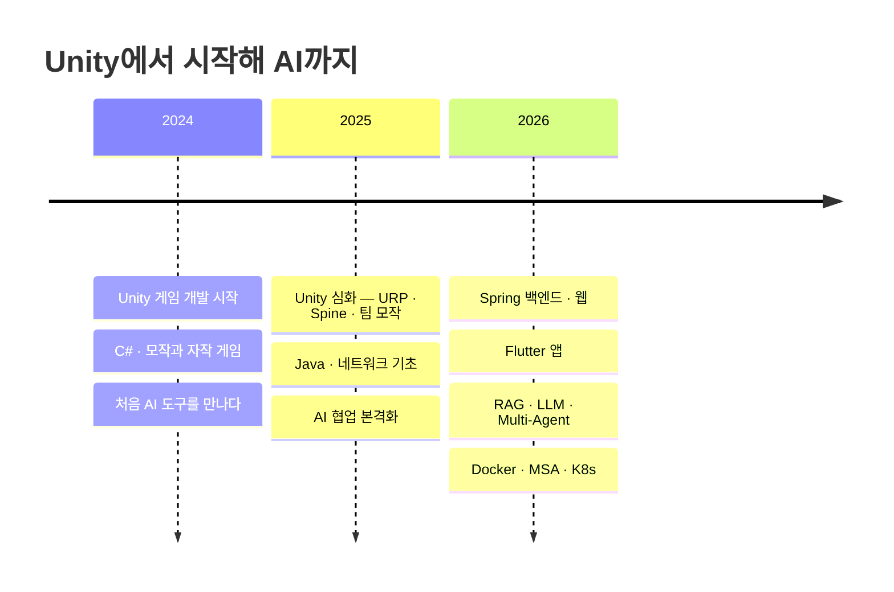

## 👋 소개

게임 클라이언트(Unity)에서 시작해 백엔드(Spring), 모바일 앱(Flutter), LLM/RAG까지 폭을 넓혀가는 개발자입니다.

- 배운 것은 늘 **직접 만들어 프로젝트로** 남깁니다.
- AI 도구를 개발 흐름에 적극적으로 끌어들여, 혼자서도 팀 규모의 결과물을 내는 방법을 실험합니다. → [AI 활용 기록](https://necessary-walleye-7cc.notion.site/AI-3657e0dfe7d681adbcabc19d8e359429)
- 공부한 내용은 [기술 블로그](https://devmong.inblog.io/)에 정리합니다.

## 🌱 성장 타임라인

## 🛠 기술 스택

**Backend**

     

**Web**

   

**App**

   

**Game**

   

**AI · LLM**

     

   

**DevOps · Tools**

   

## 📌 대표 프로젝트

| 프로젝트 | 소개 | 기술 |
| --- | --- | --- |
| [하루 기록](https://github.com/MaoEmong/haru-record) | 위치 흐름을 자동 수집해 하루의 이동 경로와 머문 곳을 정리해주는 앱 | Flutter, Riverpod, Drift |
| [여기 한국](https://github.com/MaoEmong/travel_platform) | 여행 계획부터 숙소 예약까지 하나로 잇는 통합 여행 플랫폼 (4인 팀) | Spring Boot, Mustache, JavaScript/CSS |
| [Synapse](https://github.com/MaoEmong/synapse-team-archive) | 노트 → 지식 그래프 → AI 플래시카드 → 간격 반복 학습 SaaS 졸업 프로젝트 (7인 팀) | Spring, Flutter, K8s, Kafka |
| [LangGraph-Rag](https://github.com/MaoEmong/LangGraph-Rag) | 개인용 AI 비서 RAG 시스템 — 하이브리드 검색, OCR, 리랭킹, E2E 평가 | Python, LangGraph, FastAPI |
| [컬트 오브 더 램 모작](https://github.com/MaoEmong/imitation_CultOfTheLamb) | 5인 팀 3주 제작 액션 어드벤처 모작 (URP + Spine) | Unity, C# |
| [AppleGame](https://github.com/MaoEmong/AppleGame_Unity) + [랭킹 서버](https://github.com/MaoEmong/AppleGame_Server_Spring) | Unity 퍼즐 게임과 점수 저장·랭킹 조회 REST API 서버를 함께 만든 클라이언트-서버 조합 | Unity, Spring Boot, JPA |

## ✍️ 대표 글

| 시리즈 | 내용 |
| --- | --- |
| [나의 AI 활용 여정 (Chapter 1–4)](https://devmong.inblog.io/%EB%82%98%EC%9D%98-ai-%ED%99%9C%EC%9A%A9-%EC%97%AC%EC%A0%95-chapter-1-%EC%B2%98%EC%9D%8C%EC%9C%BC%EB%A1%9C-ai%EB%A5%BC-%EB%A7%8C%EB%82%98%EB%8B%A4-2024-178903) | 2024년 AI와의 첫 만남부터 Multi-Agent 체계를 갖추기까지의 기록 |
| [Multi-Agent 개발 워크플로우 가이드](https://devmong.inblog.io/multiagent-%EA%B0%9C%EB%B0%9C-%EC%9B%8C%ED%81%AC%ED%94%8C%EB%A1%9C%EC%9A%B0-%EA%B0%80%EC%9D%B4%EB%93%9C-183630) | 여러 AI 에이전트를 조합해 개발 생산성을 끌어올리는 실전 가이드 |
| [AI 특화 모델 — TTS·STT 비교](https://devmong.inblog.io/ai-%ED%8A%B9%ED%99%94-%EB%AA%A8%EB%8D%B8-stt-speech-to-textwhisper-187554) | Whisper · faster-whisper · XTTS · Piper 등 음성 모델 직접 비교 분석 |
| [인증/보안 시리즈](https://devmong.inblog.io/) | OAuth 2.0 · OIDC · PCI DSS · httpOnly Cookie 등 인증 흐름 정리 |

## 📊 GitHub

 

