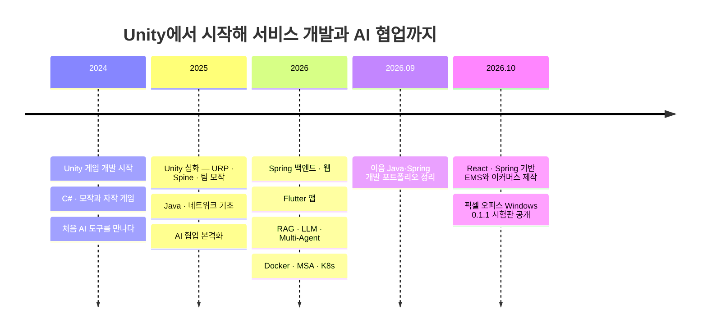

## 👋 소개

게임 개발(Unity)에서 출발해 서버(Spring), 웹(React), 모바일 앱(Flutter)과 AI를 활용한 서비스로 경험을 넓혀가고 있습니다.

- 최근에는 **사원관리 시스템 EMS**, **AI 작업 관리 앱 픽셀 오피스**, **이커머스 서비스**를 만들고, **이음의 문제 해결·검증 사례**를 정리했습니다.
- 요구사항과 작업 방향을 정하고 AI 도구로 구현·검증을 진행하며, 판단 근거와 확인한 결과를 프로젝트에 남깁니다. → [AI 활용 기록](https://necessary-walleye-7cc.notion.site/AI-3657e0dfe7d681adbcabc19d8e359429)
- 기능 구현부터 오류 처리, 테스트와 배포까지 이어서 경험하고, 배운 내용은 [기술 블로그](https://devmong.inblog.io/)에 정리합니다.

## 📌 대표 프로젝트

[프로젝트별 설명·화면·PDF를 모은 포트폴리오](https://maoemong.github.io/)에서 전체 작업을 확인할 수 있습니다.

| 프로젝트 | 최근 작업과 확인할 내용 | 주요 기술 |
| --- | --- | --- |
| [EMS · 사원관리 시스템](https://github.com/MaoEmong/ems-ai-team-portfolio) | 사원·조직·근태·휴가·데모 급여·평가 관리. 권한 검사, 변경 이력, AI 기능과 자동 검증을 함께 정리한 웹 서비스 · [화면 갤러리](https://github.com/MaoEmong/ems-ai-team-portfolio/blob/master/docs/screenshots/README.md) | Java, Spring Boot, React, TypeScript, MySQL |
| [픽셀 오피스 · Pixel Office](https://github.com/MaoEmong/pixel-office) | Claude Code·Codex의 팀 구성, 대화·회의·작업 진행을 관리하는 Windows 앱. 부서 전환 시 명령 대상 동기화, 오류의 쉬운 설명과 원문 확인 · [0.1.1 시험판](https://github.com/MaoEmong/pixel-office/releases/tag/v0.1.1) · [화면 27장](https://github.com/MaoEmong/pixel-office/blob/main/docs/screenshots/README.md) | Flutter, Dart, TypeScript, Node.js |
| [이음 · Java·Spring 개발 포트폴리오](https://github.com/MaoEmong/ieum-portfolio-clean) | 사람별 기록·약속 관리 서비스에서 다룬 서버 오류 구분, 실행 설정 검사와 AI 협업 사례. 선별한 독립 예제와 테스트로 판단·검증 과정을 설명 · [PDF](https://github.com/MaoEmong/ieum-portfolio-clean/blob/main/output/pdf/ieum-v1-portfolio.pdf) | Java, Spring Boot, PostgreSQL, Flutter |
| [이커머스 · 최근 공개](https://github.com/MaoEmong/commerce-ai-portfolio) | 상품 탐색부터 주문·결제·환불·배송·반품과 관리자 운영까지 연결한 쇼핑몰. 중복 요청 방지와 결과가 불명확한 요청의 복구를 다룸. 결제·제품 AI는 대역으로 동작 · [소개·화면·PDF](https://maoemong.github.io/projects/commerce/) | Java, Spring Boot, React, TypeScript, PostgreSQL |

픽셀 오피스로 AI 팀의 작업을 관리하며 EMS와 이커머스 프로젝트를 제작했습니다. 사용하는 도구의 문제를 수정하고, 그 도구로 서비스를 만드는 과정을 함께 경험했습니다. 프로젝트별 README에는 구현 내용과 검증 결과, 아직 확인하지 못한 범위를 구분해 남깁니다.

### 최근 작업 · 2026.10

- **이커머스 공개:** 고객·관리자 화면, 설계 설명과 실행 방법을 정리했습니다. 공개본의 프런트엔드 검사 319개와 서버 단위 검사 40개, 새 데이터베이스에서의 기동 확인을 기록했습니다. 서버 통합 검사는 이번 공개본에서 재실행하지 않았으며, 실제 결제사·실제 AI 모델·외부 배포는 미연결입니다.
- **픽셀 오피스 0.1.1 배포:** 부서별 명령 대상과 오류 안내를 개선했습니다. 배포본 검사와 남은 확인 사항은 [검증 기록](https://github.com/MaoEmong/pixel-office/blob/main/docs/release/0.1.1/VERIFICATION.md)에 정리했습니다.

## 🌱 성장 타임라인

## 🛠 기술 스택

**Backend**

       

**Web**

     

**App**

   

**Game**

   

**AI · LLM**

     

   

**DevOps · Tools**

   

## 🗂 다른 프로젝트

| 프로젝트 | 소개 | 기술 |
| --- | --- | --- |
| [하루 기록](https://github.com/MaoEmong/haru-record) | 위치 흐름을 자동 수집해 하루의 이동 경로와 머문 곳을 정리해주는 앱 | Flutter, Riverpod, Drift |
| [여기 한국](https://github.com/MaoEmong/travel_platform) | 여행 계획부터 숙소 예약까지 하나로 잇는 통합 여행 플랫폼 (팀 프로젝트) | Spring Boot, Mustache, JavaScript/CSS |
| [Synapse](https://github.com/MaoEmong/synapse-team-archive) | 노트 → 지식 그래프 → AI 플래시카드 → 간격 반복 학습 SaaS 졸업 프로젝트 (7인 팀) | Spring, Flutter, K8s, Kafka |
| [컬트 오브 더 램 모작](https://github.com/MaoEmong/imitation_CultOfTheLamb) | 5인 팀 3주 제작 액션 어드벤처 모작 (URP + Spine) | Unity, C# |
| [AppleGame](https://github.com/MaoEmong/AppleGame_Unity) + [랭킹 서버](https://github.com/MaoEmong/AppleGame_Server_Spring) | Unity 퍼즐 게임과 점수 저장·랭킹 조회 REST API 서버를 함께 만든 클라이언트-서버 조합 | Unity, Spring Boot, JPA |

## 🧠 RAG 시스템 — 세 번의 반복

같은 문제를 세 번 다시 만들며 매번 다른 층을 파고들었습니다.

| 순서 | 프로젝트 | 파고든 지점 |
| --- | --- | --- |
| 1 | [RAG-LangChain-MCP](https://github.com/MaoEmong/RAG-LangChain-MCP) | **문서 수집** — PDF 스캔/텍스트 자동 판별, Tesseract OCR, 로더 규칙 분리 |
| 2 | [LangChain-RAG-Advanced](https://github.com/MaoEmong/LangChain-RAG-Advanced) | **검색 품질** — Parent-Document Retriever, FlashRank 리랭킹, guardrail·신뢰도 스코어링, 명령 화이트리스트 검증 |
| 3 | [LangGraph-Rag](https://github.com/MaoEmong/LangGraph-Rag) | **에이전트화와 검증** — LangGraph 노드 그래프(route→retrieve→requery→generate), DB 어댑터 추상화, E2E 평가·소크 테스트·리랭커 스윕 하네스 |

## ✍️ 대표 글

| 시리즈 | 내용 |
| --- | --- |
| [나의 AI 활용 여정 (Chapter 1–4)](https://devmong.inblog.io/%EB%82%98%EC%9D%98-ai-%ED%99%9C%EC%9A%A9-%EC%97%AC%EC%A0%95-chapter-1-%EC%B2%98%EC%9D%8C%EC%9C%BC%EB%A1%9C-ai%EB%A5%BC-%EB%A7%8C%EB%82%98%EB%8B%A4-2024-178903) | 2024년 AI와의 첫 만남부터 Multi-Agent 체계를 갖추기까지의 기록 |
| [Multi-Agent 개발 워크플로우 가이드](https://devmong.inblog.io/multiagent-%EA%B0%9C%EB%B0%9C-%EC%9B%8C%ED%81%AC%ED%94%8C%EB%A1%9C%EC%9A%B0-%EA%B0%80%EC%9D%B4%EB%93%9C-183630) | 여러 AI 에이전트를 조합해 개발 생산성을 끌어올리는 실전 가이드 |
| [AI 특화 모델 — TTS·STT 비교](https://devmong.inblog.io/ai-%ED%8A%B9%ED%99%94-%EB%AA%A8%EB%8D%B8-stt-speech-to-textwhisper-187554) | Whisper · faster-whisper · XTTS · Piper 등 음성 모델 직접 비교 분석 |
| [인증/보안 시리즈](https://devmong.inblog.io/) | OAuth 2.0 · OIDC · PCI DSS · httpOnly Cookie 등 인증 흐름 정리 |

## 📊 GitHub

